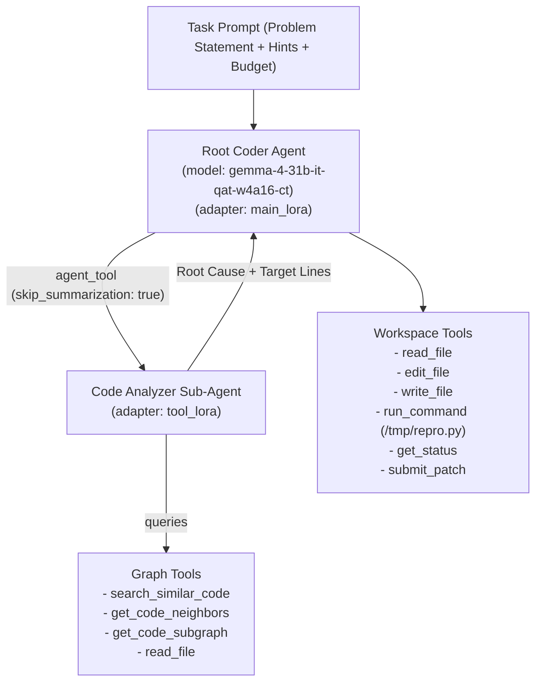

# Competitor Agent Architecture & Operational Playbook (`AGENTS.md`)

This document defines the architecture, design principles, behavioral constraints, and operational guidelines for building, debugging, and submitting autonomous developer agents in the **Google - The Gemma 4 Developer Agent Competition**.

---

## 1. Golden Operational Rules for Competition Agents

Every prompt, sub-agent configuration, and tool-calling pattern must enforce these battle-tested rules to maximize resolution rates and prevent silent evaluation failures:

### Rule 1: Keep `edit_file` Payloads Focused to Avoid `<|tool_call>` Truncation
- **The Failure Mode**: When an LLM generates a massive thought chain (e.g. 3,500+ tokens) followed by a large `edit_file` or `write_file` tool call that exceeds `max_output_tokens`, the generation is hard-truncated before the closing `</tool_call>` tag emits. The harness detects this unclosed tag, fails to parse the tool call, and burns a continuation nudge.
- **The Solution**:
  1. Set a disciplined generation configuration in `configs/sampling.yaml`:
     ```yaml
     max_output_tokens: 16384
     thinking_config:
       thinking_budget: 4096
       include_thoughts: true
     ```
  2. In your agent prompts, instruct the model:
     > *"Emit concise reasoning under 3–5 sentences before tool calls. Never generate large whole-file overwrites when a surgical 5-line `edit_file` suffices. Apply incremental edits across multiple calls rather than one massive payload."*

### Rule 2: Always Call `submit_patch()` Explicitly, Know It Is Free, and Call It Last
- **Budget Mechanic**: `submit_patch()` is marked with `@budget_gated(count_tool_call=False)`. It **does not count** against your `tool_calls` limit (e.g. 10 or 50 calls). `get_status()` is also completely free.
- **Session Termination**: Once an agent turn finishes with `patch_submitted == True`, **the harness immediately terminates the agent loop** and proceeds to Phase 2 verification.
- **Instruction**:
  1. Never call `submit_patch()` until your fix has been verified via targeted tests.
  2. Verify that `patch_size > 0` and `files_changed > 0`.
  3. Emit `submit_patch()` as your final action followed by a 1-sentence completion summary.

### Rule 3: NEVER Modify or Delete `/workspace/pytest.ini` or `/workspace/conftest.py`
- During sandbox bootstrap, the harness generates `/workspace/pytest.ini` (disabling `anyio`, ignoring external hardware fixtures) and `/workspace/conftest.py` (hermetic collection hook) and commits them into `baseline`.
- If an agent deletes or edits either file, those changes appear in `agent_patch`.
- **Automatic Discard**: In Container B, the harness forcefully wipes any modifications to test runners or configs (`git checkout HEAD -- <files>` and `git clean -f`). If your fix depended on hacking test runner configs, verification will fail!

### Rule 4: Put Scratch Reproduction Scripts in `/tmp/repro.py`, NOT in `/workspace`
- **Why**: `submit_patch()` runs `git add -N . && git diff HEAD` inside `/workspace`.
- Any untracked file left in `/workspace` (e.g. `/workspace/test_reproduce.py`) is automatically staged by `git add -N .` and embedded into your patch!
- **Best Practice**:
  - Always write temporary reproduction or verification scripts into **/tmp** (e.g. `python3 /tmp/repro.py`).
  - `/tmp` is outside `/workspace` and will **never** contaminate your unified git diff.
  - If you accidentally created a scratch file in `/workspace`, delete it (`rm -f <file>`) before calling `submit_patch()`.

### Rule 5: Isolate Context Windows Using `AgentTool` (`skip_summarization: true`)
- Traversal of codebases, reading files, and inspecting AST graphs generates large prompt histories that quickly trigger context compaction or token blowouts.
- **Hierarchical Delegation**:
  - Delegate code exploration to a specialized sub-agent (e.g. `sub_agents/code_analyzer.yaml`) configured as an `AgentTool`:
    ```yaml
    tools:
      - agent_tool:
          config_path: sub_agents/code_analyzer.yaml
          skip_summarization: true
    ```
  - `skip_summarization: true` ensures that intermediate tool logs stay within the sub-agent's session, returning only a crisp, structured finding (target file, line number, root cause) to the root coder agent.

### Rule 6: Run ONLY Targeted Tests — NEVER Run Bare `pytest` or Full-Repo Sweeps
- **Catastrophic Failure**: Running bare `pytest`, `pytest .`, or `python3 -m unittest discover` runs hundreds of repository test suites. In real-world repositories (like FastAPI, Requests, Rich), full suites take 5–15 minutes, exhausting your command timeout (300s) and wall-clock budget.
- **Pre-Existing Failures**: Many open-source repositories have pre-existing broken tests or missing external fixtures (e.g. missing Docker daemons or local databases).
- **Rule**:
  - Direct your agent: *"Run ONLY the targeted test file or method specifically verifying your fix (e.g. `pytest tests/test_sse.py -k test_single_line`). NEVER attempt to repair pre-existing repository test failures."*

### Rule 7: Zero Tolerance for Modifying Test Files
- Modifying test files (`test_*.py`, `*_test.py`, or anything under `tests/`) will be reverted by `git checkout HEAD` in Container B before grading.
- The agent must fix the bug exclusively in library implementation files under `/workspace`.

### Rule 8: Offline Execution Guarantee
- The evaluation sandbox has **no internet or PyPI access** (`network_mode="none"`).
- All dependencies are pre-installed via `/wheels` into Python site-packages.
- Instruct your agent: *"Do NOT attempt to run `pip install` or download packages. All dependencies are pre-installed."*

### Rule 9: Build and Refer Strictly from `gemma-4-developer-agent/submission/`
- All current and future agent configurations, sub-agents, prompts, and adapters must follow the standardized layout in `gemma-4-developer-agent/submission/`.
- **Directory Canonical Schema**:
  ```text
  submission/
  ├── agent.yaml             # Single declared base model, instructions, and tools
  ├── eval_config.yaml       # Operational budget limits
  ├── configs/sampling.yaml  # Temperature, top_p, thinking_budget
  ├── prompts/               # Markdown instructions (!include prompts/system.md)
  ├── sub_agents/            # AgentTool / sub-agent YAML configs
  ├── adapters/              # SafeTensors LoRA weights (adapters/<name>/)
  └── skills/                # ADK skills (skills/<skill_name>/SKILL.md)
  ```
- **Packaging Integrity**:
  - The submission zip **must** be created directly from inside `gemma-4-developer-agent/submission/` (i.e. `agent.yaml` sits at the root of `submission.zip`).
  - Never place arbitrary Python scripts in the root of `submission/` (`compile_submission` rejects non-whitelisted extensions).

---

## 2. Multi-Agent Hierarchy & LoRA Specialization

Under the competition's **Single Base Model Rule**, all agents must declare `model: gemma-4-31b-it-qat-w4a16-ct`. However, you can attach up to 8 distinct LoRA adapters (`adapters/`):



### 2.1. Recommended Sub-Agent Topology
1. **Cartographer / Analyzer Sub-Agent (`code_analyzer.yaml`)**:
   - **Tools**: `search_similar_code`, `get_code_neighbors`, `get_code_subgraph`, `read_file`.
   - **Adapter**: `tool_lora` (fine-tuned on repository AST localization and root-cause tracing).
   - **Prompt**: Focuses strictly on identifying the buggy symbol, call path, and minimal diff proposal.
2. **Synthesizer / Root Coder Agent (`agent.yaml`)**:
   - **Tools**: `run_command`, `read_file`, `edit_file`, `write_file`, `get_status`, `submit_patch`, plus `agent_tool: code_analyzer`.
   - **Adapter**: `main_lora` (fine-tuned on surgical 3-tier edits, targeted pytest execution, and self-correction).
   - **Prompt**: Coordinates the overall issue resolution, invokes the analyzer, applies edits, tests in `/tmp`, and calls `submit_patch()`.

---

## 3. Local Development vs. Competition Submission Strategy

### 3.1. Local Development on Non-GPU Machines (CPU / Low-RAM)
Because this PC does not have a dedicated GPU:
1. **Use `gemma-4-e2b-it` Locally**:
   - `gemma-4-e2b-it` is a 2B parameter Edge Gemma model officially registered in `setup_gemma_model_registry()`.
   - It runs efficiently on CPU or with lightweight quantization (e.g. via Ollama or Hugging Face transformers on CPU).
   - Use it to:
     - Validate agent YAML syntax and include paths.
     - Verify tool schema parsing (`gemma4` tool-call parser).
     - Test multi-agent delegation between root agent and sub-agents.
     - Validate sandbox container setup and command execution.
2. **Kaggle Notebooks for Full-Scale Testing**:
   - Use Kaggle's free GPU instances (T4 / P100 / L4) to run larger validation sets or test QAT weights.
3. **Kaggle Submission Swapping**:
   - For official Kaggle submission, simply update the `model:` field in `agent.yaml` and any `sub_agents/*.yaml` to:
     ```yaml
     model: gemma-4-31b-it-qat-w4a16-ct
     ```
   - Package the root directory into `submission.zip`.

---

## 4. Research Novelty & Kaggle Paper Track Strategy

The competition features a dedicated **Paper Track** awarding prizes for novel, publishable research advancing autonomous coding agents on consumer/open models.

### 4.1. Is Standard DPO / Basic Reflection Novel Enough?
- **Honest Assessment**: No. Naive trajectory-level DPO (labeling an entire 20-turn SWE-bench run as "chosen" vs "rejected") and standard text-based self-reflection (like Reflexion) are well-explored baselines from 2023–2024.
- **Core Weakness of Trajectory DPO in SWE-bench**:
  - **Credit Assignment Failure**: An agent might execute 12 brilliant tool calls and fail solely because of a single misplaced comma or an overly broad `edit_file` call. Marking all 12 good actions as "rejected" pollutes policy training.
  - **Context Drift**: Trajectory-level rewards do not teach the model *when* to stop exploring or *how* to respect tool output truncation limits.

### 4.2. Novel Proposed Framework: **PatchGRPO** (Graph-Constrained Group Relative Policy Optimization for Verifiable Program Repair)

To produce an exceptional, top-tier research paper for the Kaggle Paper Track, we formulate **PatchGRPO**:

```
                       Task Problem Statement
                                 │
                                 ▼
                     Topological Search (NetworkX)
                     [Induced k-hop Subgraph Localization]
                                 │
                                 ▼
                     State S_t: Bug Locus Context
                                 │
                 ┌───────────────┼───────────────┐
                 │               │               │
                 ▼               ▼               ▼
         Candidate P_1     Candidate P_2   Candidate P_3
        (Overly Broad)     (Syntax Error)  (Surgical 3-Line Fix)
                 │               │               │
                 ▼               ▼               ▼
           pytest Fails     SyntaxError     pytest Passes (exit=0)
           (R_1 = -1.0)     (R_2 = -2.0)    (R_3 = +1.5)
                 │               │               │
                 ▼               ▼               ▼
          git rollback     git rollback    submit_patch()
                 └───────────────┬───────────────┘
                                 ▼
                 Compute Group Relative Advantage
                 A_i = (R_i - mean(R)) / std(R)
                                 ▼
                 Critic-Free Policy Update
                 L_PatchGRPO(θ) = E[ min(r_i * A_i, clip(...) * A_i) - β * D_KL ]
```

#### Key Novel Innovations for the Paper:
1. **Solving the "Plausible Patch" Problem in Automated Program Repair (APR)**:
   - LLMs notoriously generate patches that bypass immediate assertion checks by introducing hallucinated helper methods or breaking caller/callee invariants.
   - PatchGRPO bounds the model's action space to the $k$-hop neighborhood of the repository call graph (`CustomMultiDiGraph`), penalizing edits that violate graph invariants.
2. **Critic-Free Group Advantage with Instant Git Rollbacks**:
   - Instead of doubling VRAM consumption with a separate value network ($V(s)$), PatchGRPO samples a group of $G=4$ candidate patches for the same state $S_t$.
   - The harness evaluates each candidate in Container A, executes an instant `git checkout HEAD` rollback, and normalizes advantages across the group.
3. **Multi-Objective Deterministic Reward Engine**:
   - Evaluates patches across three objective signals: (a) Python AST syntax validity ($R_{\text{syntax}}$), (b) Targeted `pytest` pass/fail status ($R_{\text{test}}$), and (c) Graph-invariance compliance ($R_{\text{graph}}$).
4. **Asymmetric Dual-LoRA Synergy under Single-Model Constraint**:
   - Exploit vLLM's multi-LoRA feature (`--lora-modules`) to specialize two lightweight LoRAs ($r=16$) on top of `gemma-4-31b-it-qat-w4a16-ct`:
     - **Cartographer LoRA**: Specialized in graph navigation and root-cause localization.
     - **Synthesizer LoRA**: Fine-tuned via PatchGRPO on surgical string replacements and targeted verification.

---

## 5. Week-by-Week Execution Plan (Starting with Week 1)

Aligned with `WeekByWeek_Plan.csv`:

### 📅 Week 1 (Oct 1 – Oct 7) — CURRENT WEEK
- **Hackathon & Research Milestones**:
  - [x] Review evaluation harness, libraries (`swegemma`, `adk-submission`, `adk-eval-core`), and dual-container lifecycle.
  - [x] Create comprehensive `GUIDE.md` and `AGENTS.md`.
  - [ ] Set up local Python virtual environment (`.venv`) and calculate required libraries via `pyproject.toml`.
  - [ ] Run baseline Gemma 4 agent configuration on 5 sample tasks from `tasks.jsonl`.
  - [ ] Log baseline failure modes: token truncation, context blowouts, command timeouts, and syntax errors.
- **Harness & Evaluation Platform Focus**:
  - Inspect ADK container lifecycle, `agent.yaml`, and sandboxed execution in `/workspace`.
  - Log task timeouts, turn counts, and token burn per task.
- **Python Practice**:
  - Arrays & Hash Maps: Two Sum, Group Anagrams, Subarray Sum Equals K.

### 📅 Week 2 (Oct 8 – Oct 15)
- Implement code-graph exploration tools (`search_similar_code`, `get_code_subgraph`).
- Prune noisy dependencies from context before feeding to Gemma.
- Harness: Build deterministic execution tool that runs pytest and returns parsed AST tracebacks.
- Eval: Define pass@1 and cost-per-resolved-issue metrics.
- Trees & BSTs: LCA, Tree Traversals, Path Sum (parallels AST traversal).

### 📅 Week 3 (Oct 16 – Oct 23)
- Generate 50+ execution trajectories; classify successful vs. failing runs (Rejection Sampling).
- Harness: Implement automated patch rollback mechanism if unit tests fail on proposed git diff.
- Eval: Trajectory logging, tool-calling syntax error rates, context drift measurement.
- Graphs (BFS / DFS / TopoSort): Course Schedule, Clone Graph, Number of Islands.

### 📅 Week 4 (Oct 24 – Oct 31)
- Train lightweight LoRA / DPO adapter on winning trajectories using Hugging Face TRL / Unsloth.
- Plug adapters into ADK `adapters/` folder (`main_lora`, `tool_lora`).
- Harness: Verify adapter loading inside offline evaluation container.
- Eval: Compare baseline vs. Graph+LoRA agent across 20 validation tasks.
- Heaps & Priority Queues: Top K Frequent Elements, Merge K Sorted Lists, Task Scheduler.

### 📅 Week 5 (Nov 1 – Nov 7)
- Run full benchmark ablation runs.
- Compile empirical results (Token savings %, Resolution Rate %, Latency).
- Eval Platform: Generate publication-grade LaTeX tables and trajectory flowcharts for the paper.
- Backtracking & Sliding Window: Subsets, Permutations, Longest Substring.

### 📅 Week 6 (Nov 8 – Nov 12)
- Draft 3,000-word Kaggle Writeup (Title, Abstract, Methods, Results, Citations).
- Final submit by Nov 12, 11:59 PM UTC.
- Freeze and verify public notebook reproducibility and standalone repo.
