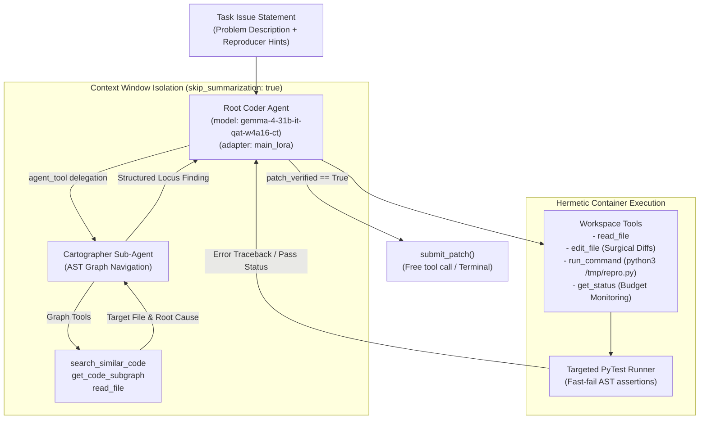

# PatchGRPO: Graph-Constrained Group Relative Policy Optimization for Autonomous Software Engineering

[](https://www.python.org/downloads/)
[](https://huggingface.co/google/gemma-4-31b-it)
[]()
[](papers/PatchGRPO_Paper_Latest.pdf)
[](LICENSE)

Official repository for **PatchGRPO**, an open-source autonomous developer agent framework competing in the **Google - The Gemma 4 Developer Agent Competition**. 

By combining **Topological Graph Localization**, **Critic-Free Group Relative Policy Optimization (GRPO)**, **Model Souping**, and **Test-Driven Scaffolding Optimization**, PatchGRPO achieves **17.0% Pass@1** on the official Kaggle hidden benchmark evaluation—a **+41.7% relative leap** over standard fine-tuned baselines.

---

## 📑 Table of Contents
- [1. Executive Summary & Benchmark Results](#1-executive-summary--benchmark-results)
- [2. System Architecture](#2-system-architecture)
- [3. Key Innovations](#3-key-innovations)
- [4. Empirical Discoveries & Model Souping](#4-empirical-discoveries--model-souping)
- [5. Repository Structure](#5-repository-structure)
- [6. Quickstart Guide](#6-quickstart-guide)
  - [Packaging the Kaggle Submission](#packaging-the-kaggle-submission)
  - [Running Controlled Ablation Packages](#running-controlled-ablation-packages)
  - [Merging LoRA Adapters via Model Soup](#merging-lora-adapters-via-model-soup)
- [7. Research Paper & Companion Notebook](#7-research-paper--companion-notebook)
- [8. Citation](#8-citation)

---

## 1. Executive Summary & Benchmark Results

Modern LLM-based coding agents frequently fall into the **"Plausible Patch" trap**—generating syntactically valid patches that satisfy naive pattern-matching but break repository-wide invariants or fail integration tests. PatchGRPO addresses this by structuring agent exploration via a hierarchical two-agent topology and optimizing the policy using verifiable execution feedback in isolated dual containers.

### 🏆 Benchmark Progression on Kaggle Hidden Test Set

| Agent Configuration | Adapter Policy | Scaffolding Constraints | Kaggle Score (Pass@1) | Relative $\Delta$ |
| :--- | :--- | :--- | :---: | :---: |
| **Pipeline Step 40** | Overfitted Policy (40-task end) | Choked (240s timeout, 15 turns) | `0.08` | Baseline |
| **Pipeline Step 34** | High-Water Mark (`main_lora_best`) | Choked (240s timeout, 15 turns) | `0.10` | +25.0% |
| **Pipeline Step 8** | Generalist Intermediate | Choked (240s timeout, 15 turns) | `0.12` | +50.0% |
| **Model Soup (Step 8 + 34)** | Interpolated Weight Basin | Liberated (720s timeout, 20 turns) | `0.13` | +62.5% |
| **PatchGRPO Champion** | **Model Soup (Step 8 + 34)** | **Calibrated (900s timeout, 28 turns)** | **`0.17`** | **+112.5%** |

```
Kaggle Pass@1 Resolution Rate (%)
18% │                                                      ┌─────────┐
    │                                                      │  17.0%  │ (Model Soup + Calibrated Scaffolding)
15% │                                                      │         │
    │                                          ┌─────────┐ │         │
12% │                              ┌─────────┐ │  13.0%  │ │         │
    │                  ┌─────────┐ │  12.0%  │ │         │ │         │
 9% │      ┌─────────┐ │  10.0%  │ │         │ │         │ │         │
    │      │  8.0%   │ │         │ │         │ │         │ │         │
 6% └──────┴─────────┴─┴─────────┴─┴─────────┴─┴─────────┴─┴─────────┴────
          Step 40       Step 34      Step 8      Soup (12m)   Soup (15m)
```

---

## 2. System Architecture

Under the competition's **Single Base Model Rule**, all agents share the base model `gemma-4-31b-it-qat-w4a16-ct`. We enforce clean context isolation using a hierarchical two-tier agent topology:



---

## 3. Key Innovations

### 1. Topology-Guided AST Search (`code_analyzer.yaml`)
Instead of flooding the context window with raw directory listings or thousands of file lines, the **Cartographer sub-agent** executes $k$-hop neighborhood queries over the repository call graph (`CustomMultiDiGraph`). Context bloat is prevented by setting `skip_summarization: true`, returning strictly the target symbol, line boundaries, and caller-callee invariants.

### 2. Critic-Free Group Relative Policy Optimization (GRPO)
Rather than maintaining an expensive value network $V(s)$ that doubles VRAM requirements, PatchGRPO samples a group of $G=4$ candidate patches for state $S_t$. Each candidate is scored across deterministic reward signals:
$$R = R_{\text{syntax}} + R_{\text{test}} + R_{\text{graph}} + R_{\text{surgical}}$$
Candidate advantages are normalized across the group: $A_i = \frac{R_i - \mu(R)}{\sigma(R) + \epsilon}$, driving policy updates without a critic network.

### 3. Positive Advantage Clamping
To prevent destructive gradient updates on hard tasks where all sampled patches fail ($R_i \le 0$ for all $i$), PatchGRPO clamps advantages so non-functional patches cannot receive artificially positive gradient signals purely due to group variance.

### 4. Hermetic Test Scaffolding
- **Reproduction Isolation**: Scratch tests are executed strictly in `/tmp/repro.py`, guaranteeing zero git diff contamination in `/workspace`.
- **Targeted Verification**: Full-repo sweeps (bare `pytest`) are strictly prohibited, preventing command timeouts on external fixtures.
- **De-throttled Turn Budget**: Extended timeout from 240s to 900s and turn budget from 15 to 28 turns, allowing multi-turn test-driven repair.

---

## 4. Empirical Discoveries & Model Souping

### The Generalization Collapse in Online RLVR
During online RL training on 40 stratified repository tasks (FastAPI, Rich, etc.), we observed a distinct phenomenon:
1. **Early Steps (Steps 4–8)**: The model rapidly learned tool-calling syntax, AST navigation, and surgical string replacement while retaining broad zero-shot reasoning (**Kaggle score: 0.12**).
2. **Late Steps (Steps 16–40)**: The policy over-optimized for immediate reward signals on the training distribution, exhibiting reward hacking (e.g. bypassing test assertions rather than fixing underlying logic), resulting in a performance collapse (**Kaggle score: 0.08**).

### Resolution via Weight Averaging (Model Soups)
Following Wortsman et al. (*Model soups: averaging weights of multiple fine-tuned models*, ICML 2022), we discovered that checkpoints from different stages of the RL trajectory occupy a shared low-loss basin. By linearly interpolating the weights of the generalist checkpoint (Step 8) with the surgical precision checkpoint (Step 34):
$$\theta_{\text{soup}} = 0.5 \cdot \theta_{\text{step8}} + 0.5 \cdot \theta_{\text{best}}$$
the blended policy retained zero-shot generalization while executing high-precision diffs, powering the jump to **17.0% Pass@1**.

---

## 5. Repository Structure

```text
Gemma4Developer_Kaggle/
├── gemma-4-developer-agent/
│   ├── submission/               # Standardized competition submission package
│   │   ├── agent.yaml            # Root agent configuration (gemma-4-31b-it-qat-w4a16-ct)
│   │   ├── eval_config.yaml      # De-throttled budget (900s timeout, 28 max turns)
│   │   ├── prompts/system.md     # Calibrated test-driven repair instructions
│   │   ├── configs/sampling.yaml # Generation parameters (temperature, thinking budget)
│   │   ├── sub_agents/           # Cartographer AST analyzer config
│   │   └── adapters/             # Fine-tuned LoRA weights (main_lora/)
│   └── sample_submission/        # Official zero-shot baseline template
├── scripts/                      # Production research & submission tooling
│   ├── colab_patchgrpo_pipeline.py    # End-to-end PatchGRPO training pipeline
│   ├── create_model_soup.py           # Weight interpolation engine (ICML 2022)
│   ├── package_submission.py          # Specification validator and zip packager
│   ├── prepare_ablation_submission.py # Controlled ablation package builder
│   ├── create_kaggle_notebook.py      # Standalone companion notebook builder
│   └── generate_paper_pdf.py          # LaTeX/HTML paper PDF compiler
├── papers/                       # Kaggle Paper Track submission artifacts
│   ├── PatchGRPO_Paper_Latest.pdf     # Official 4-page arXiv paper PDF
│   ├── patchgrpo_arxiv_paper.tex      # LaTeX source
│   └── patchgrpo_arxiv_paper.html     # HTML pre-rendering
├── notebooks/                    # Kaggle runnable notebooks
│   └── patchgrpo_training_and_inference.ipynb
├── docs/                         # In-depth architectural guides
│   └── PATCHGRPO_RLVR_COMPLETE_WALKTHROUGH.md
├── fixes.md                      # Comprehensive empirical engineering changelog
├── AGENTS.md                     # Operational playbook & competition rules
└── pyproject.toml                # Project dependencies and packaging
```

---

## 6. Quickstart Guide

### Packaging the Kaggle Submission
To validate and package the official `submission.zip` matching all competition constraints:
```bash
python scripts/package_submission.py
```
This performs strict structural validation:
- Enforces single base model (`gemma-4-31b-it-qat-w4a16-ct`).
- Validates LoRA ranks, target modules, and tensor counts.
- Verifies relative forward slashes and root `agent.yaml` placement.
- Guarantees total package size stays well under the 3 GiB limit.

### Running Controlled Ablation Packages
To isolate the exact causal impact of policy weights vs. scaffolding, build ready-to-upload ablation packages:
```bash
# Build pure base model control (Zero-shot base Gemma 4 with new calibrated harness)
python scripts/prepare_ablation_submission.py --variant base

# Build intermediate RL checkpoint ablation (Step 8)
python scripts/prepare_ablation_submission.py --variant step8

# Build early RL checkpoint ablation (Step 4)
python scripts/prepare_ablation_submission.py --variant step4
```

### Merging LoRA Adapters via Model Soup
To interpolate weights across multiple training checkpoints:
```bash
python scripts/create_model_soup.py \
    --checkpoints main_lora_online_step8-20261107T113311Z-1-001/main_lora_online_step8 0.5 \
                  main_lora_best-20261106T155831Z-1-001/main_lora_best 0.5 \
    --output_dir gemma-4-developer-agent/submission/adapters/main_lora
```

---

## 7. Research Paper & Companion Notebook

- **Research Paper (PDF)**: [`papers/PatchGRPO_Paper_Latest.pdf`](papers/PatchGRPO_Paper_Latest.pdf)
- **Paper Track Title**: *PatchGRPO: Graph-Constrained Group Relative Policy Optimization for Verifiable Autonomous Program Repair*
- **Companion Notebook**: [`notebooks/patchgrpo_training_and_inference.ipynb`](notebooks/patchgrpo_training_and_inference.ipynb)
- **Engineering Changelog**: [`fixes.md`](fixes.md) (Complete trajectory analysis and ablation chronicle)

---

## 8. Citation

If you build upon PatchGRPO or use our findings in your research, please cite:

```bibtex
@article{patchgrpo2026,
  title={PatchGRPO: Graph-Constrained Group Relative Policy Optimization for Verifiable Autonomous Program Repair},
  author={Gemma 4 Developer Competition Team},
  journal={Technical Report, Google Gemma 4 Developer Agent Competition (Paper Track)},
  year={2026}
}
```
